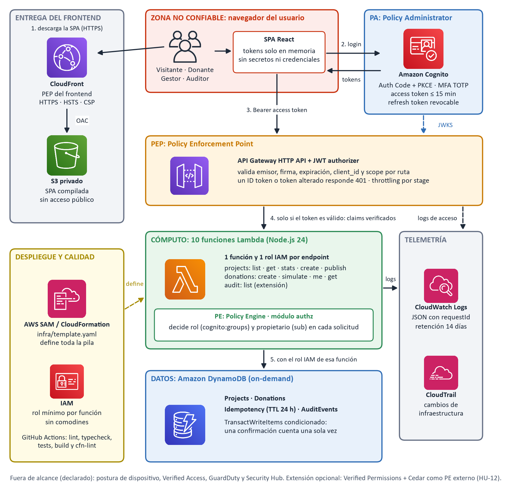

# Arquitectura

| Archivo | Contenido | Cómo se actualiza |
|---|---|---|
| `zta-architecture.png` / `.svg` | Vista general con zonas PEP, PE y PA | `python docs/architecture/build_diagram.py` |
| `request-flow.mmd` | Secuencia de una solicitud protegida | Mermaid; GitHub y VS Code lo renderizan |
| `donation-states.mmd` | Estados de una donación | Mermaid |
| `icons/` | Iconos de servicios AWS del diagrama | — |
| [`../../infra/template.yaml`](../../infra/template.yaml) | La arquitectura como código (AWS SAM) | Es la fuente de verdad |
| [`../threat-model.md`](../threat-model.md) | STRIDE, mapeo a NIST SP 800-207 y limitaciones | — |

## Límites de confianza

`Navegador (no confiable) → API Gateway (verifica el JWT) → Lambda (autoriza rol, propietario y negocio) → DynamoDB (restringido por IAM por función)`

El frontend no contiene secretos ni credenciales AWS.
